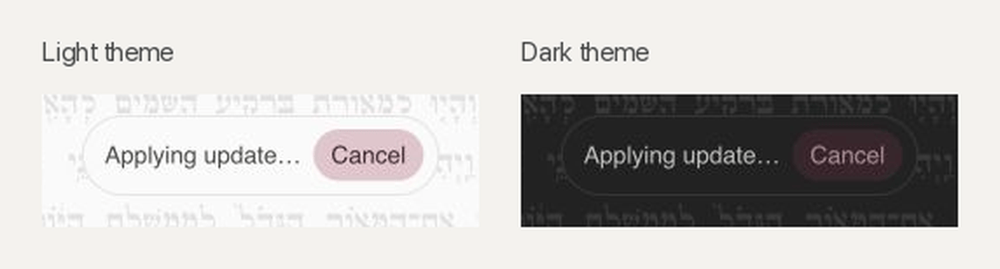

# Future theming

Color ideas saved for a later theming pass. Nothing here ships yet.

## Dusty rose

Dusty rose is a softened version of the old wine accent (`#8b2040`). It came from the update prompt's **Cancel** button mockups, where it read as warm and calm without the alarm of a solid wine fill. Cancel itself now uses a neutral ink tint with a progress line (see [app-updates.md](app-updates.md)); dusty rose is kept for theming.



The mockup derives both colors from each theme's own paper and ink, so it follows custom themes automatically:

```css
background: color-mix(in oklch, #8b2040 24%, var(--paper-color));
color: color-mix(in oklch, #8b2040 34%, var(--text-color));
```

Notes for adopting it:

- It suits gentle emphasis, such as a theme accent, selected states, or a warm highlight. It should not mark destructive actions, which need a clearer signal.
- It looks best on light paper. On the dark theme the text and fill sit close together, so check contrast and lighten the text before using it there.
